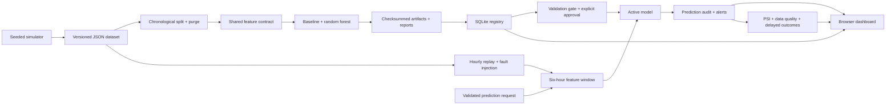
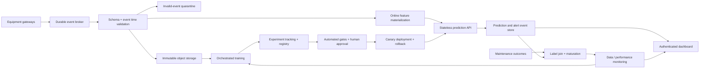

# SentinelML architecture

## Objective and boundary

Transform hourly equipment sensor histories into actionable six-hour failure warnings, while preserving enough evidence to investigate every prediction and control every model change. The MVP is deliberately a single deployable application. It demonstrates meaningful data, evaluation, serving and monitoring contracts without presenting simulated results as industrial validation.

## Runtime and modules

| Component | Responsibility | Implementation |
|---|---|---|
| `features.py` | Input schema, cadence, feature order and version | Pydantic + NumPy |
| `training.py` | Simulation, future targets, split masks, fitting, threshold selection, reports | scikit-learn |
| `service.py` | Artifact verification, replay, prediction log, registry, monitoring and deployment | SQLite + process lock |
| `app.py` | HTTP routes, startup, input validation, request counters | FastAPI |
| `static/` | Fleet, exploration, registry and monitoring interface | HTML/CSS/JavaScript |

FastAPI serves the UI and API on the same origin. The UI advances the replay through explicit POST requests; “Start replay” sends one request every three seconds. There is no background stream once the browser closes. State, model selection and replay position survive restarts. Offline reports and trusted model pickles live under `artifacts/`; the immutable sensor snapshot and SQLite database live under `data/`. `SENTINEL_HOME` selects the storage root.

## Data and feature contracts

Each observation has a machine ID, timezone-aware event timestamp and four finite sensor values. Serving accepts exactly six observations with one-hour contiguous spacing. Unknown sensor fields, missing readings and out-of-range values are rejected. The replay adapter drops simulator-only fields (`failure`, `hour`, machine ID) before feature computation. Failure labels never become predictors.

For each sensor, calculate last value, window mean, population standard deviation and least-squares slope against hourly offsets. The feature vector has 16 ordered values. Both training and inference call the same function and record `hourly-window-v1`.

For an observation at hour t, `y(t)=1` if any failure occurs in `(t,t+6h]`. The current hour's failure is not itself the future target. Windows after simulated repairs remain valid observations. The simulator's reset mechanics are simplistic; a real system should explicitly model repair downtime, censoring, equipment replacement and failure taxonomy.

## Evaluation protocol

Data spans 720 hours across 12 equipment histories. All machines use the same time cut points:

| Partition | Feature endpoint hours | Label endpoint bound | Purpose |
|---|---|---|---|
| Train | 5–425 | ≤431 | Fit transformations/model |
| Purge | 426–431 | — | Avoid train target crossing validation boundary |
| Validation | 432–569 | ≤575 | Threshold selection and deployment gate |
| Purge | 570–575 | — | Avoid validation target crossing test boundary |
| Test | 576–713 | ≤719 | Offline held-out report |

A validation/test window can include sensor history from before its boundary; that history would be observable at inference time. No future sensor or label is used in feature computation. StandardScaler is fitted only in the logistic regression training pipeline. Threshold selection maximizes validation F1 over a fixed grid from 0.10 to 0.90. The random forest uses fixed hyperparameters and seed 42. Test data is not used for fitting, threshold selection or approval gates.

The replay begins in the test period; replay metrics and offline test metrics therefore share observations. They must not be represented as two independent validation studies. Real deployment should reserve a subsequent prospective evaluation period and use rolling-origin folds plus held-out equipment to measure generalization.

Metric definitions:

- **Precision/recall/F1:** per scored hourly window at the model's fixed validation-selected threshold.
- **Average precision:** ranking quality across thresholds. Class imbalance makes this more useful than accuracy alone.
- **Brier score:** mean squared probability error; a diagnostic, not a guarantee of calibrated probabilities.
- **Event recall:** fraction of distinct failure events with at least one warning among evaluated windows. Events are identified by machine and failure hour; unrepresented events are excluded.
- **Mean warning lead time:** for each detected event, take the earliest positive warning (maximum lead) in its six-hour horizon; average over detected events only. Missed events are represented by event recall.
- **False alarm windows per machine:** count positive windows with zero target, divided by the number of machines in the evaluated partition. This is neither a rate per day nor a deduplicated incident count.

Deployment requires validation recall ≥0.70, precision ≥0.60, and F1 no more than 0.02 below the incumbent. These are demonstration thresholds, not business-derived limits. Production thresholds require maintenance cost, capacity, lead-time requirements and confidence intervals.

## Prediction evidence and explanations

Every accepted prediction stores machine ID, event timestamp, processing timestamp, optional replay hour, source, raw six-reading window, ordered feature vector/version, model version, probability, threshold, alert flag, sensor attribution and optional observed outcome. Input windows make the exact feature calculation inspectable. Model reports record dataset SHA-256, feature version, split, seed, training sample count, metrics and artifact hash.

The explanation replaces each sensor's four derived features with training medians, rescores the model and measures `original_probability − replaced_probability`. A positive value means replacing that sensor group lowered estimated risk. Median replacement may create implausible combinations and does not assign additive or causal contributions. It is labeled accordingly in the interface.

## Monitoring and outcomes

Feature PSI compares the most recent 120 replay feature vectors against a deterministic training sample using reference quantile bins. Bins extend to infinity, and an epsilon prevents log-zero errors. Monitoring warms up with at least 24 observations and flags maximum feature PSI above 0.25. Prediction PSI rescales both reference and current feature vectors through the active model, avoiding a mixture of score distributions from different model versions. It is available in the summary API.

Missing sensor and schema scenarios withhold affected predictions and create data-quality events. Equipment cards show stale predictions rather than silently treating old results as current. The outage/schema scenarios are deterministic demo injections; production needs explicit freshness SLAs and source-level schema telemetry. Validation failures on external API calls return 422 but do not currently create data-quality audit events.

Replay labels become eligible only when the clock reaches prediction hour + 6, or +30 in the delayed-label scenario. Once observed, labels are never hidden again. Returning to normal releases labels according to the standard horizon. Outcomes join by stored replay machine/hour; metrics are grouped by model version. External requests have no synthetic outcome attached.

`/health` verifies database access and active-model availability. `/metrics` provides process-local request count, server-error count and cumulative duration. It does not provide latency percentiles, endpoint labels, persistence across restarts or an external availability alert. Those require a collector and alert manager.

## Model lifecycle and consistency

The baseline is initially active; the forest is registered as a candidate. Approval verifies the validation gate and artifact before changing the active version and appending a deployment record in the same database transaction. An in-process reentrant lock serializes inference, approval and replay. Rollback restores the previous deployment and appends another record. Repeated rollback toggles the two most recent versions.

Candidate reproduction is synchronous and writes isolated job artifacts and a completed job record. It refits on the original training partition, without folding test observations into training or replacing registered artifacts. Drift only emits a review recommendation. New-data candidate registration, queued retraining, idempotency, failed-job reporting, approval identity and scheduled triggers are production-roadmap items.

Replay progress is stored after each hour; prediction inserts commit individually. A process crash mid-hour can cause duplicate predictions on restart. External prediction requests are also not idempotent. Production should use unique event IDs, atomic batch checkpoints and at-least-once ingestion with deduplication.

## Production target

Keep feature definitions shared across offline and online paths, version datasets and labels independently, and preserve point-in-time joins. Introduce a durable queue, object storage and PostgreSQL before adding replicas. Use scoped identities for model promotion, signed artifacts, separated training/serving permissions and append-only deployment audit storage. Add notifications only after alert deduplication, severity and acknowledgement rules are agreed with maintenance operators.
